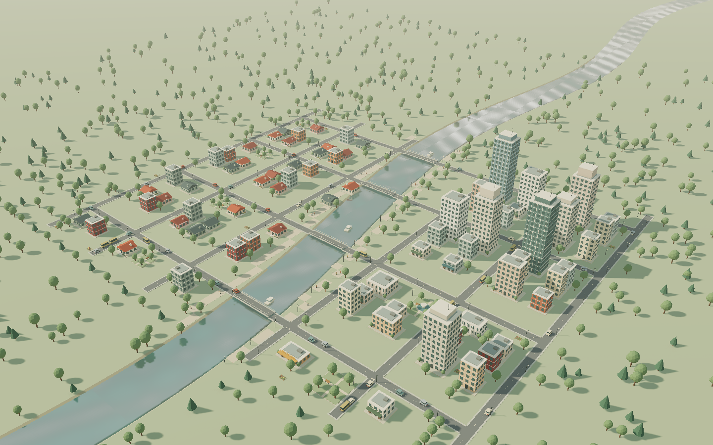

# 栖城 · Riverlight

一个以画面、氛围和自由创作为中心的 Three.js 城市沙盒。沿河建住宅与公园，在另一岸搭起现代天际线，再看灯光、车流和四季慢慢变化。

**当前是集成原型，已转入分阶段重做流程，处于 R0 基线整理。** Blender 资产、细格、道路转角和自动路人已有基础；模型精细度、完整车人逻辑、红绿灯、任意角度、桥船净空和雨伞尚未完成。最新状态以 [进度记录](docs/PROGRESS.md) 为准，下面的基础功能不代表完整验收通过。每次开发先阅读 [工作约定](AGENTS.md)。

## 启动

需要 Node.js 20.19+ 或 22.12+，以及支持 WebGL 2 的桌面浏览器。

```sh
npm install
npm run dev
```

打开终端显示的本地地址。若默认端口被占用，Vite 会选择下一个可用端口。首次打开会载入可编辑的示范城市。

```sh
npm test          # 核心数据、模型和分区回归
npm run build    # 生成 dist
npm run preview  # 本地预览生产构建
```

## 已可使用

- 37 种目录物件，其中 34 类使用 Blender 模型：住宅、商业、公共建筑、公园及街景装饰；另有道路、桥梁、步行小径。
- 点击或拖入放置、占地预览、旋转、移动、复制、建筑配色、拆除、撤销和重做。
- 连续铺路、桥梁、小汽车、公交、船和自动步行路人原型；尚无完整跟车、信号过街、目的地和雨天行为，桥船净空仍需修复。
- 128×128 起始范围，可持续向外扩展；16×16 分区加载、实例化绘制及远景简化。
- 昼夜、四季、晴雨雪雾、风、秋叶、渐变积雪、湿路积水、水面和路面倒影。
- 四种氛围预设，柔和音景，隐藏界面、环绕、车辆跟随、收藏视角及 PNG 截图。
- 自动保存、多城市收藏、切换前备份、JSON 导入导出。

历史版本截图（不代表当前重做版本的验收效果）：



## 常用操作

| 操作 | 鼠标 / 快捷键 |
| --- | --- |
| 选择、放置 | 左键；也可以从目录拖入 |
| 连续铺路或种树 | 选择工具后按住左键拖动 |
| 旋转镜头 / 平移 | 右键拖动 / 中键拖动 |
| 移动 / 缩放镜头 | 方向键或 WASD / 滚轮 |
| 旋转物件、取消 | R / Esc |
| 选择、道路、树木、拆除 | V / B / T / X |
| 撤销 / 重做 | Ctrl+Z / Ctrl+Y，macOS 可用 Cmd |
| 自由观察 / 隐藏界面 | C / H |
| 返回全景 / 时间启停 | Home / 空格 |
| 保存 | Ctrl+S / 顶部保存按钮 |

点击左侧「操作指南」可开启环绕、跟随车辆或收藏镜头。水面使用桥梁，码头需接触水面。选择已放置物件后可移动或编辑；取消移动会保留原物件。

## 存档与画质

城市保存在当前浏览器、当前网站地址下的 IndexedDB。修改后自动保存，观赏时每 45 秒保存一次。更换浏览器、端口或设备前，请在「我的城市」导出 JSON；清理浏览器数据会清除本地存档。

「精致画质」启用环境遮蔽、轻微辉光和积水反射。「流畅优先」降低像素密度并关闭这些额外效果，保留水面、阴影和基础天气。

地图范围与满密度运行能力是两件事。当前格式保护上限为 8192×8192 格、100,000 个物件；不代表这些物件同时可见时的帧率承诺。性能依赖设备、画质与城市密度。

## 项目资料

- [Git 提交约定与本机信息保护](docs/GIT_WORKFLOW.md)：每轮阶段提交、路径保护及已确认的记录规则。
- [需求与重做方案](docs/PROJECT_BRIEF.md)：后续开发的产品依据。
- [开发顺序与流程](docs/DEVELOPMENT_PLAN.md)：R0～R8 迭代、依赖、阶段出口和固定验收场景。
- [系统功能需求](docs/SYSTEMS.md)：13 个系统的职责、接口和验收标准。
- [编号待办与缺陷台账](docs/BACKLOG.md)：每项任务的优先级、前置依赖和真实状态。
- [当前进度与后续计划](docs/PROGRESS.md)：已验证、待验证、已知问题与下一步。
- [实现、验证与扩展记录](docs/IMPLEMENTATION.md)：实际交付范围、限制与模块入口。
- [素材与依赖说明](docs/ASSETS.md)：Blender 源文件、资产管线、生成内容与许可来源。

旧版入口留在 `legacy/`，旧根目录资源也保留。新版入口是 `index.html` → `src/main.js`，不加载旧版 OBJ 和音频。不要用双击 HTML 的方式启动项目。
