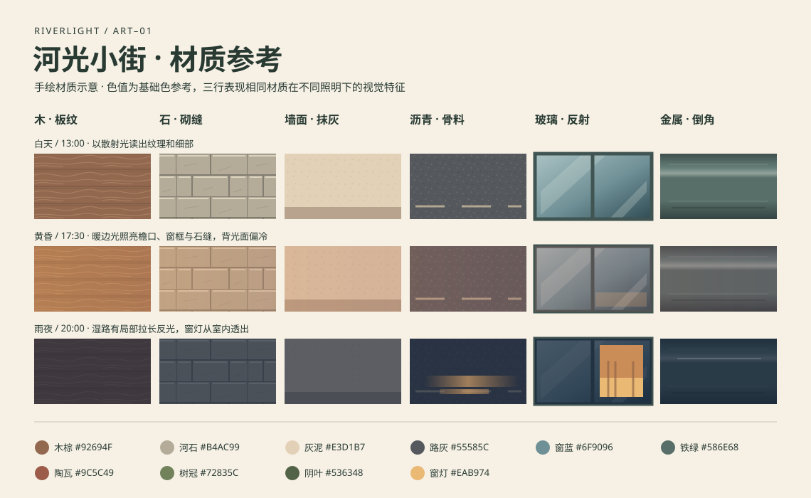
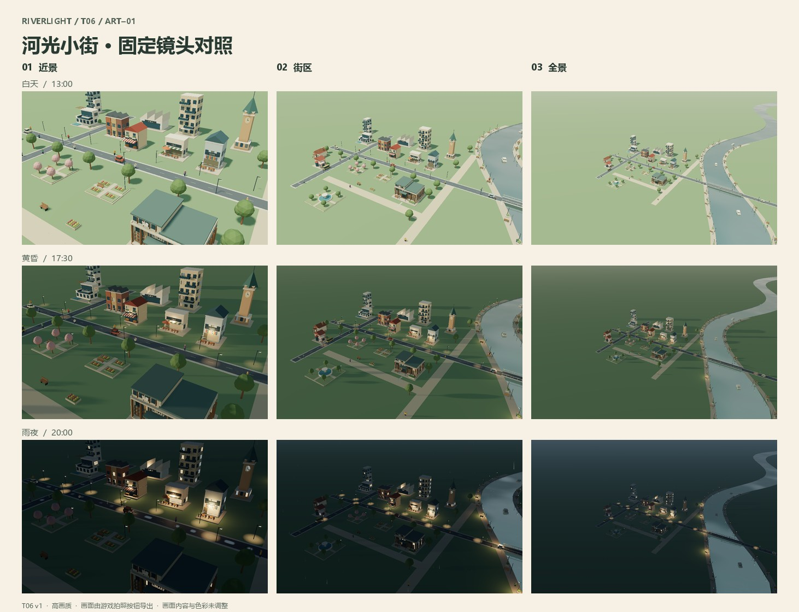

# 河光小街 · R1 画风参考

关联 [ART-01 #14](https://github.com/ExTeMe/Riverlight/issues/14)。以精致微缩模型的体量和比例组织街区，木纹、石缝、窗洞和金属倒角保留足以辨认材质的细节。暖灰墙面与青绿树冠构成街区底色，陶瓦和暖窗用于局部强调。下图是项目原绘的制作目标，色值为 sRGB 基础色参考，最终画面随光照和曝光变化。



## 比例与形体

现有场景以米计，路网格为 4 米，编辑细格为 2 米。下列尺寸是 R1 建模起点，用于同时检查门、人物、立面和街道的比例。模型尺寸、占地适配和导出契约在 [ART-02 #15](https://github.com/ExTeMe/Riverlight/issues/15) 验证。

| 对照项 | 样板尺度与造型 |
| --- | --- |
| 人与门 | 成人约 1.65–1.85 米，普通门洞约 2.1–2.4 米高。用并列人、门、台阶检查入口尺度。 |
| 住宅 | 层高约 2.8–3.2 米。坡屋顶、檐口、独立入户和错落体量形成轮廓，窗洞留出窗台和内收的阴影。 |
| 沿街商业 | 首层约 3.5–4.5 米。入口面向步道，橱窗、门、檐篷和招牌在街道视角有不同深度。 |
| 公共建筑 | 主入口可从街区镜头辨认。以共享前场、较宽开口和阅览、展览等用途对应的空间组织区分于商铺。 |
| 高层 | 以基座、主体、屋顶收口形成远景识别，立面按功能组织开口。阴影侧仍看得清层次。 |
| 公园与桥岸 | 行道树约 4–7 米高，冠下留出约 2.5 米步行空间。树荫跟随步道、座椅与停留点，保留店门和河面视线。桥头与岸线的材料连接在中景可辨。 |

立面先检查入口与开口的真实深度，再用近景可见的小倒角收住高光。远景优先保留屋顶、基座、连廊、主入口与树冠的轮廓。材质的低频色差在中景仍可辨认，微纹理在远景收敛，避免反复的高对比颗粒。

## 材质与光照

下表的粗糙度是样板试做区间，采用 0–1 的 PBR 语义。木、石、抹灰、沥青、玻璃及金属外部的漆层均按非金属面处理。只有可见的裸露金属使用金属度接近 1 的设置。

| 材质 | 近景可辨认的细节 | 白天与黄昏 | 雨夜 |
| --- | --- | --- | --- |
| 木 | 10–18 厘米宽的板材，纹路沿构件长边，端面与拼缝可辨 | 哑光木面约 .55–.75，斜光显出柔和的板纹 | 檐下保留暖棕，露天局部湿润，接缝仍清楚 |
| 石 | 约 25–50 厘米石块或铺板，砌缝、浅倒角和低对比块面差 | 粗糙度约 .65–.85，边光揭示拼缝 | 石块变深，凸边有散射反光，石缝偏暗 |
| 墙面 | 浅暖抹灰，墙脚、窗洞和檐下有不同深度，细颗粒到中景趋于均匀 | 粗糙度约 .75–.9，日照面保留层次，背阴面可读 | 大面保留柔和明暗，雨水积聚的位置可轻微加深 |
| 沥青 | 细骨料低对比，标线有轻微磨损，路缘与路面分材质 | 干路约 .75–.9，斜光下道路仍比墙面暗 | 湿区可降到 .3–.55，灯光附近有短而分散的反射，积水边缘可读 |
| 玻璃 | 窗框与内收窗洞，保留室内深浅关系，反射随角度变化 | 粗糙度约 .08–.25，反射天空同时隐约看见室内，黄昏起窗灯渐亮 | 按房间分组点亮，橱窗有深度，灯光保留窗框边界 |
| 金属 | 栏杆、支架、门把手的截面可读，倒角留出窄高光 | 喷漆面约 .35–.55，裸露边缘的高光更窄 | 用窄边光勾出形体，粗糙漆面保留柔和反射 |

白天以柔和方向光和可读的接触阴影建立体积。黄昏让低角度暖光落在屋檐、窗框和树冠边缘，背光面保留偏冷的层次。雨夜分开处理住宅窗、橱窗和路灯，明亮橱窗仍可辨门框与室内，路灯形成局部光池。湿路与河面各有反射范围。植被按行道、庭院、停留点和水岸成组，枝叶有阴阳面，避免遮住整段橱窗或公共入口。

## T06 固定镜头

以实际城市渲染对照上面的制作目标。三列使用 T06 的「近景」「街区」「全景」按钮，目标点均为 `(-65, 0, 0)`。依次比较「白天」「黄昏」「雨夜」。时间固定，镜头位置与目标以 `(x, y, z)` 米记录。



上图使用渲染基线 `8979ba39e7750cd5947f7f3a649a13aa7b609`，T06 v1，布局种子 `20261103`。Chromium 156 无头模式，高画质，视口 1280 × 800，照片 960 × 600。拼版等比缩放，车辆与雨粒位置随模拟变化。当前 T06 v2 在同组镜头中换入白榆办公楼，重拍时会看到新高层。

| 视图 | 相机位置 | 判读重点 |
| --- | --- | --- |
| 近景 | (-38.6, 26.4, 40.8) | 比较入口进深、窗框、立面分材和树荫。细纹与窄高光需要进一步贴近对应资产观察。 |
| 街区 | (-10, 55, 85) | 看沿街用途、公共建筑前场、行道树的间隔以及到水岸的连接。 |
| 全景 | (31.25, 96.25, 148.75) | 看屋顶层次、街区留白和河岸轮廓。比较暗部边界与局部暖光是否仍可读。 |

当前近景能辨认面包房檐篷、商铺开口和不同屋顶，画面下缘裁掉部分图书馆入口，木纹、石缝等微细特征需在单体镜头复核。黄昏能看见延长的阴影。雨夜已有分散的路灯光池和亮窗，个别招牌和橱窗细节仍被亮斑压住。材质与画风以样板继续调校，由用户确认。

浏览器打开 `?scene=T06` 即可进入独立场景。每次选择时段后先「保存并重载」，从对应时刻进入场景，雨夜稍等灯光与雨粒显现。然后逐一选择三个镜头，用「拍张照片」导出画面。也可以运行下列命令重新采集九张照片，输出到 `test-results/dynamic-evidence/`。

```sh
npx playwright test --config playwright.evidence.config.js art-direction.spec.js
```
