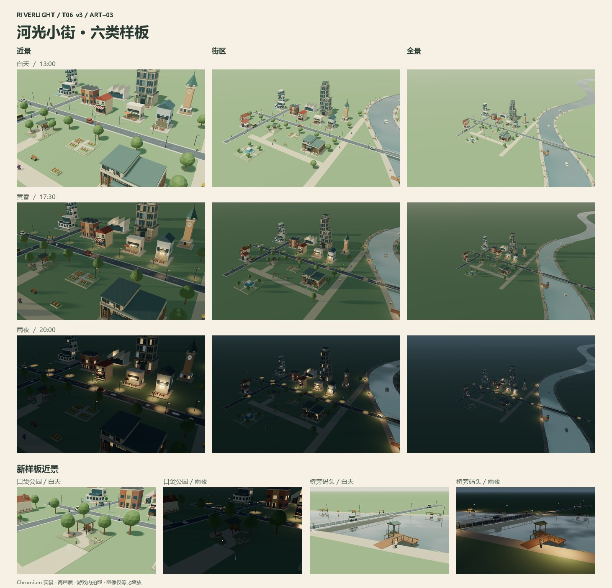
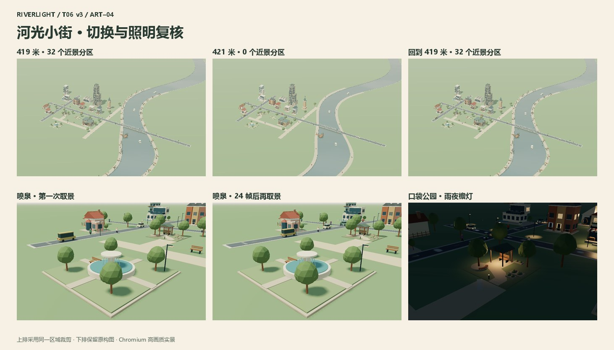

# 栖城建筑设计规范与河光小街画风参考

关联 [ART-01 #14](https://github.com/ExTeMe/Riverlight/issues/14)。以精致微缩模型的体量和比例组织街区，木纹、石缝、窗洞和金属倒角保留足以辨认材质的细节。河光小街样板以暖灰墙面与青绿树冠构成街区底色，陶瓦和暖窗用于局部强调。下图是项目原绘的制作目标，色值为 sRGB 基础色参考，最终画面随光照和曝光变化。


## 建筑设计规范

### 1. 城市尺度与建筑辨识度

同一种建筑用途要提供可在同一座城市中并存的多个独立方案，覆盖不同的建筑风格与生活氛围。每个方案分别设计场地、内部空间和使用节奏。

建筑可以大胆塑形，保留现实可建的尺度、承重、构造与生活动线。住宅从街口走到家门、餐桌或私密小院的过程应当可以理解。

全城共享合理的尺度感、细节密度和整体氛围，但不要求所有建筑遵循相同的体量、轮廓、空间组织或设计语言。

每个方案可以自由组合不同的体块组织、轮廓、虚实比例、立面节奏、材料关系，以及与街道、水岸和地形的连接方式。同一种用途可以有多种空间解法，不同用途的建筑也可以采用截然不同的设计思路。

鼓励具有独特性、空间逻辑和视觉辨识度的建筑设计。不要依赖更换材质、颜色、装饰或简单调整尺寸来制造差异，而应从整体形态、空间结构、功能组织及建筑与环境的关系出发，让不同方案具有真正不同的设计特征。

把不同方案放在一起，用默认游戏镜头观察，即使所有建筑统一成灰模，仍然应该能够清楚辨认各自的造型特点。

### 2. 占地、体量与场地

允许建筑根据自身的用途、设计理念和空间需求，自主决定占地面积、宽度、进深、高度、层数和体块比例。

不要预设所有建筑必须使用统一的地块尺寸，也不要为了适应固定的空间范围而强行压缩、拉伸或简化原本合理的建筑构思。

建筑可以根据需要向水平方向延伸、向垂直方向发展，或采用分散、连接、错层、架空、悬挑及其他空间组织方式。具体如何组织体量，应取决于建筑本身，而不是套用固定模板。

允许不同建筑之间存在明显的规模差异，同时保持与人物、车辆、街道、公共空间和周边建筑的尺度关系合理。

考虑建筑实际占据的空间，以及入口、通道、外部设施、活动区域和必要的周边环境如何与主体衔接。不要只关注建筑主体的外观，而忽略它与地面的接触方式和实际使用空间。

### 3. 内部空间与功能组织

把内部空间视为建筑整体设计不可分割的一部分，而不是完成外立面后才填充的内容。

每栋建筑都应该根据自身的功能、规模和设计理念，形成合理且具有细节的内部空间。

自主考虑内部功能分区、楼层关系、空间连接、通行路径、垂直交通、结构支撑、服务设施，以及不同区域之间的开放和私密关系。

内部空间不应只是被外墙包围的空盒子，也不应只是为了让窗户看起来丰富而随意放置家具和装饰。

让房间、走廊、楼梯、平台、结构构件、设备和其他内部元素形成符合建筑用途的空间关系。根据各个区域的实际功能，自主设计适合的内部设施、局部结构、材质细节和空间特征。

重视内部空间的纵深感和多层次关系。对于能够从外部观察到的区域，让视线能够穿过前景的结构或边界，进入中间的活动空间，并进一步感受到后方的空间、遮挡和深度。

内部细节不必均匀分布。根据空间用途、重要程度、观察距离和可见性，自主调整细节密度。重要区域可以具有丰富的空间组织和局部设计，次要区域则可以适当简化，但仍需保持整体结构与功能上的合理性。

建筑外部形态与内部空间应相互影响。 外立面的特殊造型可以反映内部的空间结构，内部的功能需求也可以决定建筑的轮廓、开口、楼层和体量关系。

避免出现外观非常复杂，但内部完全空洞、缺乏功能逻辑，或者内部结构与外观明显不匹配的情况。

即使某些区域不会被直接进入，也应考虑其空间存在的合理性。让建筑整体呈现出真正经过设计的内部结构，而不是只有漂亮外壳的模型。

### 4. 开放程度与视线

把通透度当作可变化的空间特征，而不是固定要求建筑必须拥有大量玻璃或开放立面。

根据用途、私密性、空间结构和观察角度，自主决定哪些空间开放、半遮挡或封闭，以及开放到什么程度。

通透可以通过玻璃、开口、挑空、廊道、结构间隙、错层关系及其他空间连接方式实现，不局限于使用透明材质。

对于能够观察到内部的区域，应让视线感受到近处的边界、中间的活动空间和更远处的结构深度，而不是只看到单一的背景平面。

不同建筑可以在不同位置、以不同尺度展示内部。有些建筑可以具有大面积开放空间，有些可以通过少量开口透露局部活动，也有些可以保持相对封闭的外观。

通透程度应服务于建筑的用途、空间体验和整体设计，不必为了展示内部而破坏建筑本身合理的封闭性或私密性。

### 5. 建筑构件与动态机制

把建筑自身的动态变化视为建筑设计的一部分，而不仅仅是为静态建筑添加人物活动或环境特效。

允许建筑根据自身用途、结构特点和设计理念，拥有独特的运动构件、动态设施或可变化的建筑形态。

动态可以来自建筑构件的移动、旋转、开合、滑动、伸缩、升降、折叠、组合与分离，也可以来自建筑内部机械设施、功能系统及其他具有合理空间逻辑的运动机制。

这些只是可能的运动形式，不代表必须采用，也不限制创造其他类型的动态设计。

不同建筑可以拥有完全不同的动画方式、运动规模、速度、节奏和复杂程度。某些建筑的动态变化可以显著改变整体轮廓和空间布局，某些则只涉及局部结构或设施，也允许完全没有明显动态结构的建筑。

让建筑动画与建筑自身的设计逻辑紧密关联。

考虑运动构件如何连接建筑主体、通过什么结构完成运动、运动时需要怎样的空间，以及不同状态下如何与周围结构相互配合。

动态变化应具有合理的起因和作用，而不是让建筑为了产生动画而无意义地运动。

运动可以影响建筑的外观、内部空间、通透程度、通行关系、使用方式、光照、阴影和周围环境。

对于具有动态结构的建筑，应考虑动画发生前、进行中和结束后的空间状态，让不同状态都保持合理的结构关系与视觉表现。

不必让所有动画持续运行。可以根据建筑用途和环境状态，自主设计触发条件、运行间隔、持续时间和变化节奏。

部分建筑可以通过偶尔发生的大幅度变化产生辨识度，部分建筑则可以通过长期存在的微小运动表现生命力。

让建筑在静止状态下也具有完整的造型与设计价值，而不是只能依靠动画效果来体现特色。

### 6. 白天的采光与室内层次

把白天的自然光视为塑造建筑形态、内部空间和整体氛围的重要设计因素。

根据建筑的朝向、外部环境、空间结构和开口分布，自主考虑阳光如何进入建筑，以及在不同区域形成怎样的亮度、阴影和空间层次。

利用窗户、天窗、挑空、廊道、遮阳结构、内部反射及其他建筑设计手段，决定自然光能够进入哪些区域，以及光线如何沿着空间逐渐减弱。

特别注意白天室外明亮、室内却过度黑暗的问题。

避免建筑外部具有强烈日光，但从窗户、入口或开放区域向内部观察时，只能看到一片缺乏层次的黑色空间，使精心设计的内部结构和细节无法被辨认。

应综合考虑开口分布、空间进深、材质反射、环境光、人工辅助照明和画面曝光，合理处理室内外之间的亮度差异。

不要求所有内部空间都像室外一样明亮，也不应通过简单提高整体亮度消除所有阴影。

允许一些区域保持昏暗、安静或神秘，但对于需要展示空间层次的部分，应保留必要的结构轮廓、局部照明和视觉深度。

白天的人工照明也可以根据空间需求保持工作，而不是默认所有人工灯光都必须关闭。

让自然光、人工照明和建筑结构共同决定白天的内部视觉效果。

### 7. 光色、材质与照明来源

将灯光颜色作为具有充分设计自由度的空间表达手段。

不把灯光限制为单一的白色、暖黄色或冷蓝色。

不同建筑可以根据用途、材料、设计理念和氛围，自主选择不同色相、色温、饱和度和亮度的光源，并探索它们之间的组合、对比、渐变、混合与层次关系。

允许使用鲜明的多色照明，也允许采用克制的单色照明、微妙的色温变化或主要依赖自然光的设计。

彩色光源不应只出现在霓虹灯、广告牌或装饰性灯带上。它也可以参与室内照明、局部空间塑造、结构强调、功能区域区分或其他符合建筑设计的用途。

注意不同颜色的光线照射到建筑材料后产生的视觉变化，以及光线经过玻璃、半透明表面、遮挡物和反射结构后呈现的效果。

同时关注直接光、间接光、反射光和阴影之间的关系。

让光线具有明确或可以理解的来源、方向、照射范围、强度和衰减过程。

从游戏视角观察时，应该能够感受到光从哪里产生、照亮了哪些区域、被哪些物体遮挡，以及在空间中如何逐渐减弱。

避免所有表面均匀发亮、光源缺乏来源、局部过度曝光，或阴影完全失去细节。

对于发光元素，应合理区分表面自发光效果与实际空间照明。

发光表面不一定需要照亮周围环境，而负责照明的光源则应该让附近的空间、物体和阴影产生合理变化。

不必让每个发光细节都承担复杂的照明功能，但不能仅靠发光贴面来代替真正需要设计的光环境。

不同建筑可以拥有各自独特的灯光语言。不要为了统一城市风格而让所有建筑使用相同的配色方式，也不要为了强调差异而无目的地堆叠高饱和度颜色。

### 8. 夜景与昼夜过渡

把夜间灯光当作塑造空间、揭示内部活动和表现建筑个性的一部分，而不是简单地让白天的建筑变暗，再让窗户发光。

为不同建筑设计符合其用途、结构和氛围的亮暗节奏。

变化可以来自光源的位置、大小、数量、颜色、强度、照射方向、遮挡和反射，也可以来自内部活动和建筑构件的变化。

夜景可以具有大面积安静的暗处、少量局部亮点、连续的光带、不同颜色交织的照明区域，或从内部逐渐向外扩散的光线。

具体采用哪种方式，应由每栋建筑自身的特点决定。

对于发亮的窗户和开放立面，应保留窗内的明暗变化、结构遮挡、物体轮廓和前后空间层次。

避免把所有窗户处理成相同亮度与颜色的均匀发光平面，也避免让整栋建筑的所有区域在夜间同时保持完全相同的照明状态。

考虑白天、黄昏、夜晚及其他时间状态之间的连续变化。

光环境可以随着自然光强度、太阳方向、建筑使用状态和内部活动发生改变。

部分灯光可以在白天持续工作，部分可以在天色变暗时逐渐出现，也可以有一些光源只在特定活动或设施运行时开启。

灯光的亮度、颜色和照射范围可以动态变化，但不要求每栋建筑都有频繁闪烁、颜色循环或强烈的动态灯效。

允许某些建筑在夜晚保持安静和黑暗，让少量光源或偶尔发生的变化更有存在感。

灯光变化应与建筑空间、动态结构和活动状态相互呼应，而不是独立存在的视觉特效。

### 9. 场所活动与使用节奏

把城市建筑资产当作真正会被使用、会随时间变化的场所来设计。

每个方案自行决定这里可能有哪些活动、活动什么时候发生、从哪里能够观察到，以及活动结束后会留下什么空间状态或使用痕迹。

根据建筑用途、开放程度、内部组织和临街关系，选择适合的环境动态、设施动作和人物活动。

活动可以发生在建筑内部、外部、入口、平台、公共空间及其他合理的位置，不必集中在同一种区域。

同类建筑也可以具有不同的活跃程度和日夜节奏。

让活动、设施运作和建筑动画具有起因、持续时间、间隔及结束状态，并与同一场景中的光线、天气、周边活动和空间使用情况相呼应。

允许建筑内部与外部之间形成可观察的联系。例如，内部活动可以通过灯光、运动构件、局部声音所对应的视觉变化或空间使用状态体现出来。

建筑自身的动态结构也可以参与这些活动，但不要求所有活动都必须引起建筑形态变化。

不要为了让场景显得热闹而让所有设施、人物和建筑构件持续运动。

允许某些区域长时间保持静止，另一些区域以缓慢节奏变化，也允许局部发生短暂而明显的活动。

让建筑在没有活动时仍然具有完整的空间表现，而活动发生时又能自然地展示其使用方式和生命力。

### 10. 整体设计与游戏镜头

让建筑的外部形态、内部空间、结构细节、灯光设计、动态机制及环境关系共同构成一个完整的设计。

建筑中的重要设计决定应尽可能在其他部分得到合理呼应。

例如，外部结构可以影响内部空间布局，内部功能可以决定建筑的开口和轮廓，动态构件可以改变空间的使用方式，而灯光可以揭示这些结构与活动之间的关系。

这些关系不需要遵循固定模式，也不要求每一个设计元素都必须承担多种功能。

避免为了增加复杂度而无目的地堆叠体块、装饰、光效、机械结构或动画。

设计可以大胆、独特甚至非常规，但应保持自身的结构逻辑、空间关系和运动机制合理。

同时考虑建筑作为游戏资产的实际表现需求。重要特征应能在常用游戏视角和观察距离下被识别，而不是只能通过极近距离观察或特定的特写镜头才能发现。

允许局部具有精细设计，但应让细节密度与其可见性和重要程度相匹配，不要让大量无意义的细节掩盖真正重要的形态特征。

在不牺牲核心设计的前提下，兼顾模型、材质、灯光和动画的实际可实现性及运行效率。

## 比例与形体

现有场景以米计，路网格为 4 米，编辑细格为 2 米。下列尺寸是 R1 建模起点，用于同时检查门、人物、立面和街道的比例。模型尺寸、占地适配和导出契约在 [ART-02 #15](https://github.com/ExTeMe/Riverlight/issues/15) 验证。

| 对照项 | 样板尺度与造型 |
| --- | --- |
| 人与门 | 成人约 1.65–1.85 米，普通门洞约 2.1–2.4 米高。用并列人、门、台阶检查入口尺度。 |
| 住宅 | 层高约 2.8–3.2 米。坡屋顶、檐口、独立入户和错落体量形成轮廓，窗洞留出窗台和内收的阴影。 |
| 沿街商业 | 首层约 3.5–4.5 米。入口面向步道，橱窗、门、檐篷和招牌在街道视角有不同深度。 |
| 公共建筑 | 主入口可从街区镜头辨认。以共享前场、较宽开口和阅览、展览等用途对应的空间组织区分于商铺。 |
| 高层 | 以基座、主体、屋顶收口形成远景识别，立面按功能组织开口。阴影侧仍看得清层次。 |
| 公园与桥岸 | 行道树约 4–7 米高，冠下留出约 2.5 米步行空间。树荫跟随步道、座椅与停留点，保留店门和河面视线。桥头与岸线的材料连接在中景可辨。 |

立面先检查入口与开口的真实深度，再用近景可见的小倒角收住高光。远景优先保留屋顶、基座、连廊、主入口与树冠的轮廓。材质的低频色差在中景仍可辨认，微纹理在远景收敛，避免反复的高对比颗粒。

## 材质与光照

下表的粗糙度是样板试做区间，采用 0–1 的 PBR 语义。木、石、抹灰、沥青、玻璃及金属外部的漆层均按非金属面处理。只有可见的裸露金属使用金属度接近 1 的设置。

| 材质 | 近景可辨认的细节 | 白天与黄昏 | 雨夜 |
| --- | --- | --- | --- |
| 木 | 10–18 厘米宽的板材，纹路沿构件长边，端面与拼缝可辨 | 哑光木面约 .55–.75，斜光显出柔和的板纹 | 檐下保留暖棕，露天局部湿润，接缝仍清楚 |
| 石 | 约 25–50 厘米石块或铺板，砌缝、浅倒角和低对比块面差 | 粗糙度约 .65–.85，边光揭示拼缝 | 石块变深，凸边有散射反光，石缝偏暗 |
| 墙面 | 浅暖抹灰，墙脚、窗洞和檐下有不同深度，细颗粒到中景趋于均匀 | 粗糙度约 .75–.9，日照面保留层次，背阴面可读 | 大面保留柔和明暗，雨水积聚的位置可轻微加深 |
| 沥青 | 细骨料低对比，标线有轻微磨损，路缘与路面分材质 | 干路约 .75–.9，斜光下道路仍比墙面暗 | 湿区可降到 .3–.55，灯光附近有短而分散的反射，积水边缘可读 |
| 玻璃 | 窗框与内收窗洞，保留室内深浅关系，反射随角度变化 | 粗糙度约 .08–.25，反射天空同时隐约看见室内，黄昏起窗灯渐亮 | 按房间分组点亮，橱窗有深度，灯光保留窗框边界 |
| 金属 | 栏杆、支架、门把手的截面可读，倒角留出窄高光 | 喷漆面约 .35–.55，裸露边缘的高光更窄 | 用窄边光勾出形体，粗糙漆面保留柔和反射 |

白天以柔和方向光和可读的接触阴影建立体积。黄昏让低角度暖光落在屋檐、窗框和树冠边缘，背光面保留偏冷的层次。雨夜分开处理住宅窗、橱窗和路灯，明亮橱窗仍可辨门框与室内，路灯形成局部光池。湿路与河面各有反射范围。植被按行道、庭院、停留点和水岸成组，枝叶有阴阳面，避免遮住整段橱窗或公共入口。

## T06 固定镜头

以实际城市渲染对照上面的制作目标。三列使用 T06 的「近景」「街区」「全景」按钮，目标点均为 `(-65, 0, 0)`。依次比较「白天」「黄昏」「雨夜」。时间固定，镜头位置与目标以 `(x, y, z)` 米记录。



上图是 `2cdc292` 基线叠加公园与桥岸样板改动的历史样张，T06 v3，布局种子 `20261103`。Chromium 156 无头模式，高画质，视口 1280 × 800，照片 960 × 600。拼版等比缩放，车辆与雨粒位置随模拟变化。[T06 v1 实景](art-direction/t06-lighting.jpg)来自 `8979ba39e7750cd5947f7f3a649a13aa7b609`，保留作同镜头对照。

| 视图 | 相机位置 | 判读重点 |
| --- | --- | --- |
| 近景 | (-38.6, 26.4, 40.8) | 比较入口进深、窗框、立面分材和树荫。细纹与窄高光需要进一步贴近对应资产观察。 |
| 街区 | (-10, 55, 85) | 看沿街用途、公共建筑前场、行道树的间隔以及到水岸的连接。 |
| 全景 | (31.25, 96.25, 148.75) | 看屋顶层次、街区留白和河岸轮廓。比较暗部边界与局部暖光是否仍可读。 |

上图近景能辨认面包房檐篷、商铺开口和不同屋顶，画面下缘裁掉部分图书馆入口，木纹、石缝等微细特征需在单体镜头复核。黄昏能看见延长的阴影。雨夜码头的坡面和栏杆仍可辨认，个别商铺招牌和橱窗细节被亮斑压住。公园补光结果见下方复核。

浏览器打开 `?scene=T06` 即可进入独立场景。每次选择时段后先「保存并重载」，从对应时刻进入场景，雨夜稍等灯光与雨粒显现。然后逐一选择三个镜头，用「拍张照片」导出画面。也可以运行下列命令重新采集九张照片，输出到 `test-results/dynamic-evidence/`。

```sh
npx playwright test --config playwright.evidence.config.js art-direction.spec.js
```

T06 面板可以直接切换六个单体镜头。脚本会拍六类样板的日间特写，以及面包房、公园和码头的雨夜特写。

| 单体镜头 | 相机位置 | 目标 |
| --- | --- | --- |
| 住宅 | (-100, 12, 36) | (-111, 2.7, 14) |
| 面包房 | (-62, 11, 12) | (-75, 3.3, -10) |
| 图书馆 | (-33, 13, 41) | (-48, 3, 19) |
| 办公楼 | (-45, 18, 11) | (-65, 12, -28) |
| 公园 | (-68, 10, 30) | (-82, 1.1, 14) |
| 码头 | (-20, 9, 32) | (-3, .55, 13) |

## ART-04 实景复核



在 `45f32e7` 基线上叠加本轮灯位和取景脚本，以 Chromium 156 高画质、1280 × 800 视口和 0.75 像素比检查 T06 v3。近远模型实测包围盒的对应角点差不超过 5 厘米，六类样板的锚点与预算均通过。白天的喷泉出水和树影可辨，实际导入的喷泉动画通过缩放回归。两个喷泉镜头相隔至少 24 个渲染帧，未记录帧时间。

首轮复核中，419 → 421 → 419 米的近景分区数为 32 → 0 → 32，岸边家具与部分投影随之消失和恢复。本轮让分区按距离逐步切换。远景保留岸边家具、摆放的座椅和花坛、街灯及建筑和桥梁的主要投影。单个分区仍会切换网格，近景动画随远景模型停用。

2026-11-14，在 `53bd859` 基线叠加本轮远近景与取景改动，以相同浏览器配置测量。日间街区镜头有 135 个物件、6 辆车、1 艘船、36 名可见行人。最近一帧累计 1,700 次绘制、948,686 个提交三角面，含反射和后处理，WebGL 快照记录 387 个几何资源和 25 个纹理资源。固定视向缩放复测如下。

| 相机至目标距离（米） | 近景分区 / 加载分区 | 绘制次数 | 提交三角面 |
| --- | --- | --- | --- |
| 419 | 24 / 64 | 2,055 | 971,222 |
| 421 | 24 / 64 | 2,076 | 973,146 |
| 480 | 4 / 64 | 2,082 | 970,854 |
| 560 | 0 / 64 | 1,828 | 252,030 |
| 回到 419 | 16 / 64 | 2,055 | 971,222 |

回到 419 米时，回差带内的分区保留远景级，中央样板恢复近景细节。绘制次数随参与渲染的活动对象变化。帧时间和显存容量未测。

六个单体镜头用于检查小屋门廊、面包房檐篷、图书馆书架开间、办公楼退台、公园亭和码头坡面。雨夜能读出亭内木屏、座椅及步道弯道，接入小径外段仍较暗。面包房招牌附近有局部高光，玻璃以内层次偏暗。2026-11-18，用户否定现有模型，要求全部重新制作。这组画面仅记录旧版表现。

```sh
npx playwright test --config playwright.evidence.config.js art-direction.spec.js --grep ART-04
```
