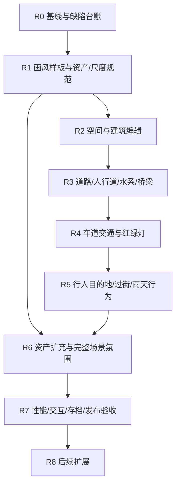

# 系统化开发流程与迭代顺序

更新：2026-10-13。采用分阶段交付；本文保留长期依赖与出口标准，任务状态直接在 GitHub 管理。

## 1. 当前判断

现有版本是可运行的集成原型，已经有模型导入、编辑、天气、道路和活动对象，但还不是完成的城市体验：

- 34 类 Blender 资产只证明类型覆盖，不证明精细度、造型多样性和整体画风已经达标。
- 道路圆角不等于完整路网；车辆曲线插值不等于车道、跟车、避碰或路口通行规则。
- 行人能够走动不等于目的地行为、可靠过街、避让和天气响应已经完成。
- 环境有雨粒子不等于人物、地面、建筑和声音都正确响应降雨。
- 桥面和船分别可见不等于净空、桥墩避让和航路已经成立。

开发以“一个系统闭环 + 与其上下游联调 + 明确验收”推进。代码能运行、自动测试通过、画面通过三者必须分开记录。

## 2. 文档职责和阅读顺序

1. 根目录 [AGENTS.md](../AGENTS.md)：每次工作的入口规则。
   同时必读 [GIT_WORKFLOW.md](GIT_WORKFLOW.md)：按合理工作边界提交、本机信息保护与已确认的记录规则。
2. [PROJECT_BRIEF.md](PROJECT_BRIEF.md)：用户需求与产品方向。
3. GitHub Issues/Projects：当前阶段任务、依赖、负责人、状态与验收证据。
4. 本文：开发顺序、阶段出口、变更流程。
5. [SYSTEMS.md](SYSTEMS.md)：系统边界、接口约定、功能需求和验收标准。
6. 本轮关联 Issue：独立范围、前置条件、复现场景、验收标准及关联提交/PR。

涉及模型再读 [ASSETS.md](ASSETS.md)，涉及现有实现再读 [IMPLEMENTATION.md](IMPLEMENTATION.md)。需求归 BRIEF，长期阶段标准归本文，接口归 SYSTEMS；任务状态、分诊、依赖与证据归 GitHub。PROGRESS 只保留无法及时同步的必要交接，不作为看板镜像。

## 3. 依赖关系

美术标准前置，避免先批量生产低质量模型；全城美术扩充后置，避免道路尺度、建筑入口和材质接口变化后重做所有资产。保存兼容、自动检查、性能预算和可观察性贯穿每个阶段。

## 4. 迭代计划与阶段出口

| 阶段 | 本阶段交付 | 必须通过的出口 | 此时不扩张的内容 |
| --- | --- | --- | --- |
| R0 基线 | 核对当前代码、自动测试、原型功能、已知缺陷；固定测试存档与镜头；完成本文档体系 | 已知问题有编号和复现方式；运行/构建/存档检查有证据；当前限制说清楚 | 不继续批量加建筑和随机场景细节 |
| R1 美术与资产样板 | 一小块可重复拍摄的样板街区；住宅、沿街商业、公共建筑、高层、公园/游乐设施、桥岸六类代表；白天/黄昏/雨夜样张；统一模型、材质、入口、占地和 LOD 规范 | 近景看得见结构和细节，中景分得出用途，远景轮廓协调；不是靠换色充数量；记录实际资源成本 | 不一次重做全部 34 类资产；不以复杂交通遮盖画面问题 |
| R2 空间与编辑 | 米制世界坐标、细格吸附、角度放置、真实占地碰撞、预览/编辑/历史/迁移 | 0°、15°、30°、45°、90°及自由角度不穿楼；旋转后选择、移动、撤销和存档一致；旧城无损恢复 | 不在四向格子假设未解除前制作任意角度道路依附功能 |
| R3 路网、水系与桥梁 | 道路中心线/车道/路口、人行道/斑马线、曲线与坡度；河岸与航路；桥梁净空、桥墩和引桥 | 画面、车道曲线、步行图来自同一几何定义；道路转弯切线连续；最大测试船安全过桥；桥上道路和人行道无断层 | 暂不做立交、隧道、电车；车辆先用调试代理检查路线 |
| R4 车辆与信号 | 路径规划、跟车、转弯减速、停车线、路口占用、红绿灯状态机、道路修改后重规划 | 车不闯红灯、不相互穿透、不进入已堵死路口；信号冲突矩阵无相冲绿灯；转弯不越出车道；桥上高度正确 | 不用随机换邻居代替目标路线，不先做复杂公交运营 |
| R5 行人闭环 | 自动生成、目的地、步行路线、停留、过街等待、避让；雨伞/避雨；编辑后安全重规划 | 路人自动沿连续人行道到达场所；行人与车辆遵守同一信号；雨中露天行人撑伞，屋檐/室内收伞；无穿楼、踏水或明显瞬移 | 不把人物加入自由摆放目录；不做完整人口/经济模拟 |
| R6 资产与城市氛围 | 按 R1 标准分批升级全资产；住宅/商业等结构变体；沿街密度、天际线、连续水岸；四季昼夜、湿地、光照、声景联合调校 | 固定镜头下白天/黄昏/雨夜/秋景/雪景清晰协调；模型、车、人、船和天气行为同时成立；近中远景都达标 | 不把泛光、满屏雾或随机树群当作细节替代品 |
| R7 可交付版本 | 性能分档、资源释放、存档/迁移、长时运行、交互与导出回归；文档、截图和可运行构建 | 基线场景无错误；关键交互和存档回归通过；记录硬件/分辨率/人数/车数及真实性能；剩余问题分级明确 | 不在收尾阶段插入未验证的大系统 |
| R8 后续迭代 | 更多桥型、地形编辑、复杂交通、蓝图、巡游、更多资产和音频等 | 每项仍按同样的定义—实现—验证流程进入 | 不宣称本阶段规划已交付 |

以上是依赖顺序，不是虚构的工期承诺。每个阶段可以拆成多个小迭代，但同一时间只保留一个主要交付目标；阻塞该目标的依赖修复优先。

## 5. 每一项功能的标准开发流程

### 开始条件（Definition of Ready）

- 有任务 ID、所属系统、用户可见目标、明确范围和验收场景。
- 已查清依赖与现有数据结构；涉及格式升级时先写迁移方案。
- 有可以运行/观察的最小复现场景，不直接在全城中猜原因。
- 对资产/渲染任务，先确定参照镜头、比例和画面标准；对模拟任务，先确定规则与状态机。

### 执行步骤

1. 读规范与现状，在 GitHub 选择依赖已满足的一项或一组紧密关联任务。
2. 更新任务为“进行中”，记录本轮范围、需要验证的风险与前置条件。
3. 先实现数据与规则，再接显示和 UI；共享同一事实来源，避免“画出来的路”和“算法走的路”各算一套。
4. 在小场景检查：规则测试 → 可视化调试 → 正常界面实测。算法使用固定种子和可重复时间步。
5. 接入完整城市，验证与上下游系统的交互、旧存档和资源生命周期。
6. 修复本次引入的问题，再补画面或行为证据；不要因发现新点子而顺手扩展范围。
7. 在 Issue 记录提交、检查和必要证据，进入待验收；行为/接口变化时才同步对应 IMPLEMENTATION/SYSTEMS，资产/使用方法变化时同步 ASSETS/README。
8. 检查本轮 diff 与暂存范围，在独立修复/功能步骤/资产批次等合理边界 commit。每个阶段可以有多个提交，不积压到整个项目结束；结束时报告提交情况。push/发布遵循用户另行授权。

### 完成条件（Definition of Done）

- 用户可见行为达到任务验收标准，并在实际运行中检查；不是仅存在对应函数。
- 相关规则回归通过，生产构建成功；无新错误或未解释的警告。
- 数据兼容、取消/撤销、拆改后的失效处理和资源释放已考虑。
- 视觉任务有固定镜头截图，动态行为有重复观察/调试记录或短视频；版本、证据和局限写入关联 Issue/PR，供后来者访问。画风、模型和氛围由用户确认后完成。
- 与任务有关的规范已同步。仍有关键缺陷时保持待验收或阻塞，在 Issue 描述原型边界，不能标完成。关闭 Issue 不等于已发布；阶段出口通过后才完成阶段父任务/Milestone。

## 6. 最小验收场景集

| 场景 | 要检验的边界 |
| --- | --- |
| T01 建筑编辑院 | 不同尺寸、邻接边界、细格错位、任意角度、移动/复制/撤销/保存 |
| T02 道路实验场 | 直线、左右弯、S 弯、T 字/十字、断头、跨分区连接、坡道与步道 |
| T03 信号十字路口 | 直行/左转/右转、排队、黄灯、全红、过街、堵塞和道路删除 |
| T04 滨水桥段 | 窄/宽河段、桥下净空、桥墩、最大船型、桥上车与人、雨夜倒影 |
| T05 生活街区 | 住宅—商店—公园目的地、过街、多人避让、屋檐、降雨撑伞与停雨收伞 |
| T06 美术对照街区 | 同镜头近/中/远景，白天/黄昏/雨夜/秋景/雪景；建筑类别和变体辨识 |
| T07 城市规模与保存 | 扩区、加载/释放、密度档位、长时运行、旧版升级、导入导出 |

当前这些是要建立的固定场景规格，不代表所有场景文件已存在；对应任务及证据见 GitHub Issues。

## 7. 变更和问题处理

- 新需求先查重，在 Issue 明确系统、范围、验收、优先级和依赖，再决定当前或后续阶段；不因为提交了新需求就立即修改所有规范。
- bug 记录复现、预期/实际结果、版本和影响；P0 调整当前工作，其余先分诊。原问题未解决则重开，独立新缺陷另建并关联原任务。
- 优先级：P0 数据损坏/启动失败/核心流程阻断；P1 首个可交付版本必须满足的正确性和核心体验；P2 质量/多样性/性能提升；P3 后续扩展。
- 模型“还不够好”不能关闭为主观反馈：转化为轮廓、比例、开口、入口、材质、街面细节、变体和镜头证据等可审查条目。
- 设计变更记录到文档，明确哪些旧结论失效。不得未经说明把首版缺陷降为遥远路线图。
- 不要求用户为每个可逆步骤重复确认。阶段结果应可供用户审阅；新的用户反馈按优先级修订下一轮。

## 8. 此刻的下一步

先完成 R0 的可复现场景和缺陷基线，再做 R1 小规模画风/资产样板。已写出的细网格、行人与道路代码保留为原型，不继续堆功能。桥船穿模、雨天不撑伞、任意角度、车流规则和红绿灯均已登记为必须处理的任务，不再遗漏。
