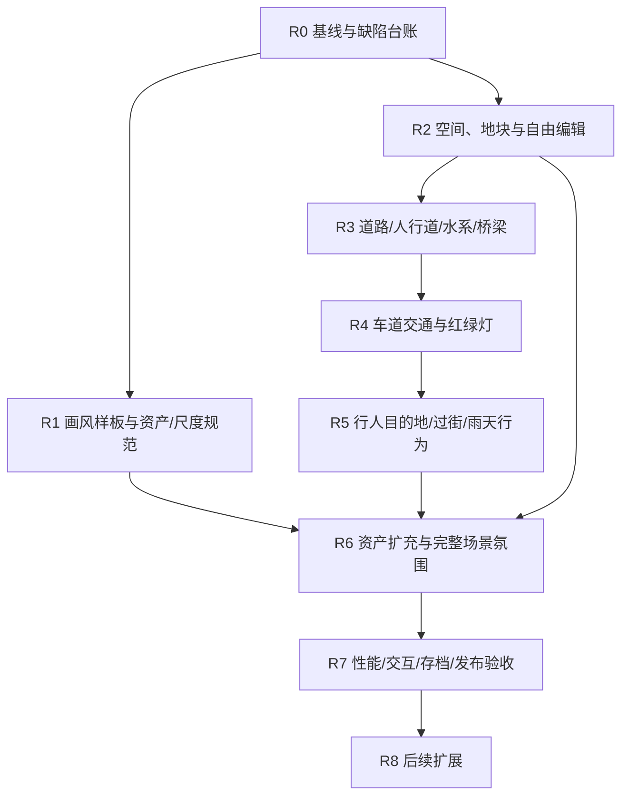

# 系统化开发流程与迭代顺序

更新：2026-11-10。采用分阶段交付；本文保留长期依赖与出口标准，任务状态直接在 GitHub 管理。

## 1. 当前判断

现有版本是可运行的集成原型，已经有模型导入、编辑、天气、道路和活动对象，但还不是完成的城市体验：

- 34 类 Blender 资产只证明类型覆盖，不证明精细度、造型多样性和整体画风已经达标。
- 道路圆角不等于完整路网；车辆曲线插值不等于车道、跟车、避碰或路口通行规则。
- 行人能够走动不等于目的地行为、可靠过街、避让和天气响应已经完成。
- 环境有雨粒子不等于人物、地面、建筑和声音都正确响应降雨。
- 桥面和船分别可见不等于净空、桥墩避让和航路已经成立。

开发以“一个系统闭环 + 与其上下游联调 + 明确验收”推进。代码能运行、自动测试通过、画面通过三者必须分开记录。

## 2. 文档职责

本文只维护阶段依赖、出口和固定场景。阅读范围、文档职责及开发操作见 [GIT_WORKFLOW](GIT_WORKFLOW.md#工作入口)；任务状态、依赖与证据以 GitHub Issues/Projects 为准。

## 3. 依赖关系

R0 已提供可复现基线。R1 已有资产尺度、原点和锚点可供 R2 使用，余下视觉验收和远近细节复核按各自 Issue 保留。当前主线先验证空间、地块和自由编辑；道路及步行依赖这套空间契约，全库精修与示范城重排依赖实测尺度。保存兼容、交互、性能预算和可观察性随各阶段同步验证。

## 4. 迭代计划与阶段出口

| 阶段 | 本阶段交付 | 必须通过的出口 | 此时不扩张的内容 |
| --- | --- | --- | --- |
| R0 基线 | 核对当前代码、自动测试、原型功能、已知缺陷；固定测试存档与镜头；完成本文档体系 | 已知问题有编号和复现方式；运行/构建/存档检查有证据；当前限制说清楚 | 不继续批量加建筑和随机场景细节 |
| R1 美术与资产样板 | 一小块可重复拍摄的样板街区；住宅、沿街商业、公共建筑、高层、公园/游乐设施、桥岸六类代表；白天/黄昏/雨夜样张；统一模型、材质、入口、占地和 LOD 规范 | 近景看得见结构和细节，中景分得出用途，远景轮廓协调；不是靠换色充数量；记录实际资源成本 | 不一次重做全部 34 类资产；不以复杂交通遮盖画面问题 |
| R2 空间与编辑 | 米制空间、可画可调的矩形地块、不同尺度建筑、真实占地与细吸附、自由角度和地块内偏移 | T01 看得到宽窄、进深和高低差异；整块移动与块内编辑独立，碰撞/入口/历史一致，旧城无损恢复 | 复杂区划规则、多建筑地块和批量蓝图后置 |
| R3 路网、水系与桥梁 | 道路中心线/车道/路口、人行道/斑马线、曲线与坡度；河岸与航路；桥梁净空、桥墩和引桥 | 画面、车道曲线、步行图来自同一几何定义；道路转弯切线连续；最大测试船安全过桥；桥上道路和人行道无断层 | 暂不做立交、隧道、电车；车辆先用调试代理检查路线 |
| R4 车辆与信号 | 路径规划、跟车、转弯减速、停车线、路口占用、红绿灯状态机、道路修改后重规划 | 车不闯红灯、不相互穿透、不进入已堵死路口；信号冲突矩阵无相冲绿灯；转弯不越出车道；桥上高度正确 | 不用随机换邻居代替目标路线，不先做复杂公交运营 |
| R5 行人闭环 | 自动生成、目的地、步行路线、停留、过街等待、避让；雨伞/避雨；编辑后安全重规划 | 路人自动沿连续人行道到达场所；行人与车辆遵守同一信号；雨中露天行人撑伞，屋檐/室内收伞；无穿楼、踏水或明显瞬移 | 不把人物加入自由摆放目录；不做完整人口/经济模拟 |
| R6 资产与城市氛围 | 按 R1 标准分批升级全资产；住宅/商业等结构变体；沿街密度、天际线、连续水岸；四季昼夜、湿地、光照、声景联合调校 | 固定镜头下白天/黄昏/雨夜/秋景/雪景清晰协调；模型、车、人、船和天气行为同时成立；近中远景都达标 | 不把泛光、满屏雾或随机树群当作细节替代品 |
| R7 可交付版本 | 性能分档、资源释放、存档/迁移、长时运行、交互与导出回归；文档、截图和可运行构建 | 基线场景无错误；关键交互和存档回归通过；记录硬件/分辨率/人数/车数及真实性能；剩余问题分级明确 | 不在收尾阶段插入未验证的大系统 |
| R8 后续迭代 | 更多桥型、地形编辑、复杂交通、蓝图、巡游、更多资产和音频等 | 每项仍按同样的定义—实现—验证流程进入 | 不宣称本阶段规划已交付 |

以上是依赖顺序，不是虚构的工期承诺。小团队按依赖、共享资源、接口稳定性和审查能力协调并行范围，不设置固定任务数量上限；阶段出口不因此放宽。需要提前探索时，维护者明确范围与前置假设，不能将探索结果算作阶段验收。

## 5. 系统实现顺序

任务开始、检查与完成条件统一见 [GIT_WORKFLOW](GIT_WORKFLOW.md#工作入口)。城市系统按以下顺序逐步集成：

1. 在最小场景确定数据、规则和接口，再接显示与 UI；几何、路径和通行规则共用事实来源。
2. 通过规则测试、可视化调试与正常界面实测验证闭环；算法使用固定种子和可重复时间步。
3. 接入完整城市，验证上下游交互、旧存档、编辑失效处理和资源生命周期。

阶段出口以本文件第 4 节为准，不能用原型存在或测试通过替代用户可见行为与画面达标。

## 6. 最小验收场景集

| 场景 | 要检验的边界 |
| --- | --- |
| T01 建筑编辑院 | 真实面积与街区层次；地块与建筑分别旋转、偏移和缩地，贴边、跨分区、越界、复制/撤销/存档 |
| T02 道路实验场 | 直线、左右弯、S 弯、T 字/十字、断头、跨分区连接、坡道与步道 |
| T03 信号十字路口 | 直行/左转/右转、排队、黄灯、全红、过街、堵塞和道路删除 |
| T04 滨水桥段 | 窄/宽河段、桥下净空、桥墩、最大船型、桥上车与人、雨夜倒影 |
| T05 生活街区 | 住宅—商店—公园目的地、过街、多人避让、屋檐、降雨撑伞与停雨收伞 |
| T06 美术对照街区 | 同镜头近/中/远景，白天/黄昏/雨夜/秋景/雪景；建筑类别和变体辨识 |
| T07 城市规模与保存 | 扩区、加载/释放、密度档位、长时运行、旧版升级、导入导出 |

当前这些是要建立的固定场景规格，不代表所有场景文件已存在；对应任务及证据见 GitHub Issues。

R0 最小输入、隔离入口与操作判定见 [BASELINE.md](BASELINE.md)；它提供 BASE-02 的固定基础，不表示完整 T01～T07 已交付。

## 7. 变更和问题处理

- 优先级：P0 数据损坏/启动失败/核心流程阻断；P1 首个可交付版本必须满足的正确性和核心体验；P2 质量/多样性/性能提升；P3 后续扩展。
- 模型“还不够好”不能关闭为主观反馈：转化为轮廓、比例、开口、入口、材质、街面细节、变体和镜头证据等可审查条目。
- 设计变更记录到文档，明确哪些旧结论失效。不得未经说明把首版缺陷降为遥远路线图。

## 8. 待办复核与当前顺序

本轮复核了 59 个开放 Issue，覆盖 8 个阶段父任务（#2–#9）和 51 个子任务（#14–#64）。R0 的验收和已关闭历史保留。下面记录依赖与执行调整，验收状态仍在 GitHub 维护。

| 范围 | 复核后的执行顺序 |
| --- | --- |
| R1 美术样板 #14–#17 | 保留 T06 六类样板、现有 LOD 跳变记录和视觉确认。尺度、枢轴、锚点技术交付供 R2 使用，剩余视觉项与可独立的修复并行 |
| R2 空间/编辑 #18–#22 | #18 米制、分层空间与跨分区查询 → #19 地块/实例契约与旧城迁移 → #20 旋转轮廓、地块包含和边界校验 → #21 细吸附、数值偏移与自由角度 UI → #22 T01 整条建造/保存闭环 |
| R3 道路、水系 #23–#30 | 在 R2 闭环之后接正式道路/岸线及步行接口。#26 消费世界入口姿态，#27 提供真实岸线，#28–#30 联合验证桥船净空和航路 |
| R4 车辆与信号 #31–#38 | 路网契约稳定后进入。固定步长、车道和路口规则沿用既定依赖，保留拆改与安全重规划回归 |
| R5 行人与天气 #39–#43 | 用经过地块偏移和旋转的入口、遮蔽锚点接步行图，地块或建筑拆改触发重算；保留过街、雨伞和避雨验收 |
| R6 资产/环境/构图 #44–#54 | 先用 T01 的用途、尺度与密度对照确定全库改造依据，等道路及行人闭环后批量精修。#52 用多种面宽、进深、高度和留白重排示范城；保留夜景、季节、湿地、音景与 T06 验收 |
| R7 性能/保存/UI/发布 #55–#59 | 空间索引压力测试、地块/偏移的保存与编辑回归提前做到 R2；完整规模测量、曲线路网/桥高存档、全功能 UI 与发布验收仍在 R7 |
| R8 扩展 #60–#64 | #62 的区域复制、街区蓝图复用片区、地块和局部姿态。更多桥型、交通、内容及媒体扩展仍在后续 |

R2 的尺度和编辑闭环在独立 T01 复查。R3 从米制道路契约、曲线坡道和路口起步，随后由 [ROAD-04 #26](https://github.com/ExTeMe/Riverlight/issues/26) 连接共享车道、步行图和入口。现有示范城与旧存档继续作为兼容基线，画风和构图按对应任务跟踪。
